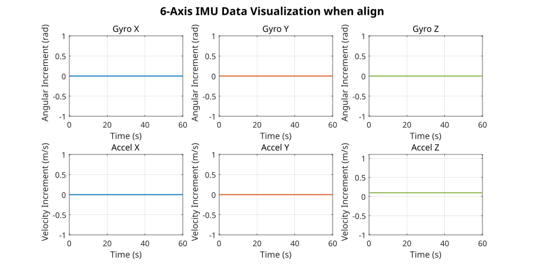
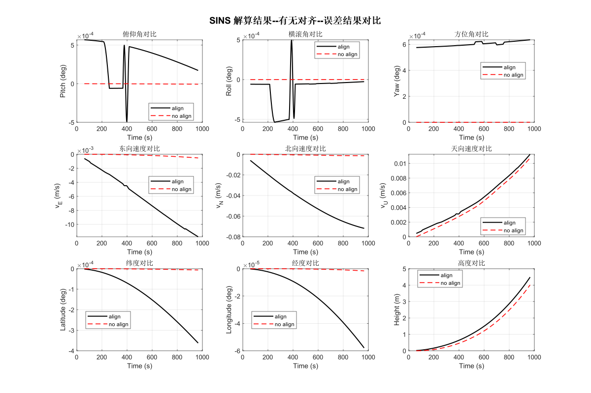
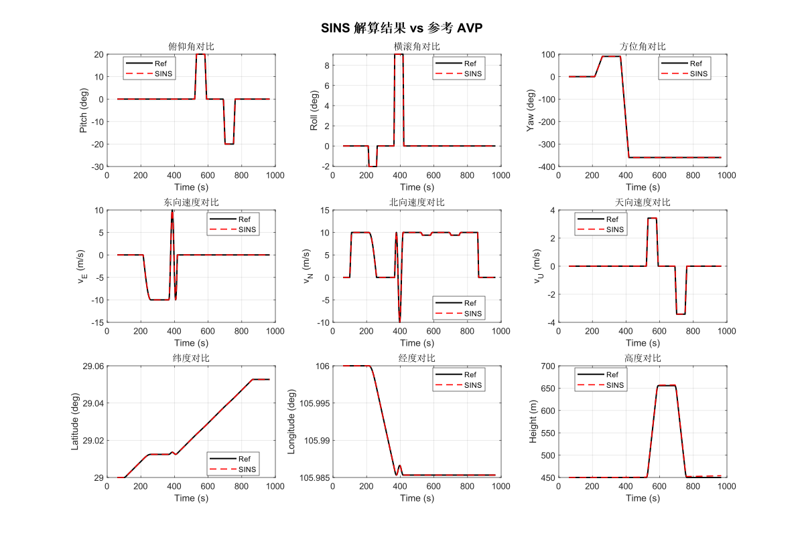
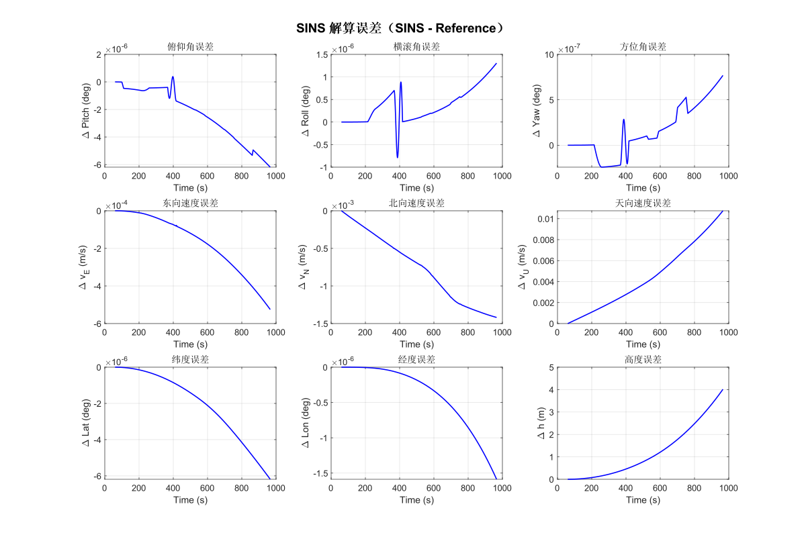

# SINS_Solver

**二矢量粗对准**：故假设对准地点地理位置已知（重力速度、地球自转在导航系下的角速度已知），且载体相对地静止（相对地没有明显线运动和角运动）；

【运用中为避免传感器高频噪声和高频环境晃动，取一段时间内加计、角计平均值后，进行“二矢量定姿”】

------

单子样+前一周期  六轴惯性器件 姿态-ENU速度-纬经高 导航解算

data2imuavp.mat：三个变量，imu为7列（x\y\z陀螺角增量，x\y\z加计速度增量，t采样时间）；

avp：为10列参考导航AVP结果（俯仰、横滚、方位角，东-北-天速度，纬经高，时间t），参考导航结果由单子样+前一周期解算得到

avp0：初始时刻的AVP 

avp0_with_bias：对初始的姿态添加小的估计扰动，以体现出对齐的作用

------

由前60s数据，先用双矢量对准算法对准，再作惯性导航解算，与参考avp比较导航误差、并与为进行对齐(存在小偏差)的初姿SINS解算对比

